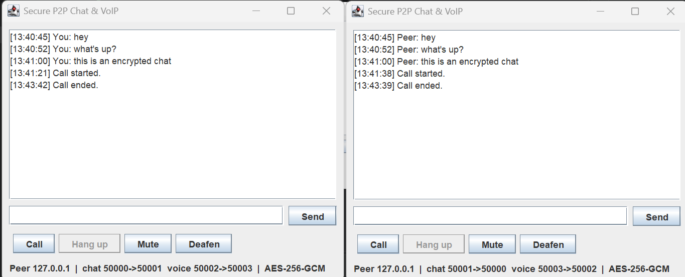
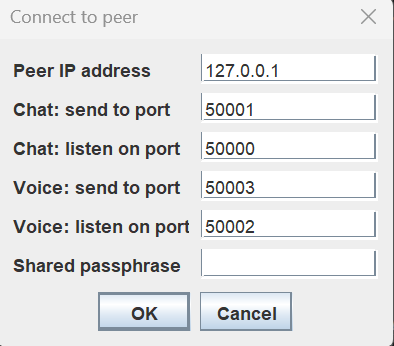

# Secure P2P Chat & VoIP over UDP

[](https://github.com/sterlouk/CN2_AUTH_ChatAndVoIP/actions/workflows/ci.yml)

A peer-to-peer desktop app for real-time text chat and voice calls between two computers, written in plain Java (`java.net`, `javax.sound`, `javax.crypto`) with **no runtime dependencies**.

All traffic is **end-to-end encrypted and authenticated with AES-256-GCM**, using a key derived from a shared passphrase. The receiver rejects tampered, forged, replayed, reflected and stale packets. See **[SECURITY.md](SECURITY.md)** for the threat model and protocol.



<p align="center">
  <br>
  <em>Each peer enters the other's IP, mirrored ports and the shared passphrase.</em>
</p>

## Background

The app started as the main assignment for **Computer Networks II** (ECE, Aristotle University of Thessaloniki, 2024–25). The assignment was to implement UDP chat and VoIP on top of a GUI skeleton provided by the course ([template](https://github.com/siavvasm/CN2_AUTH_ChatAndVoIP)).

| Version | What it is |
|---|---|
| [`course-submission`](https://github.com/sterlouk/CN2_AUTH_ChatAndVoIP/tree/course-submission) | The version I submitted: working plaintext UDP chat and VoIP |
| `master` | Extended after the course: encryption, anti-replay, bug fixes, tests, CI |

### What changed after submission

**Security**
- Added AES-256-GCM encryption with PBKDF2 key derivation.
- Added sequence-number and timestamp replay protection, and reflection and type-confusion checks.

**Bugs fixed**
- **Truncated chat messages.** A reused `DatagramPacket` kept the length of the previous datagram, so a long message after a short one was cut off.
- **Calling again failed.** "Close call" only set flags; the sockets and audio lines stayed open, so a second call failed with *port in use* or *line unavailable*.
- **Mute and Deafen could not be undone.** Their flags also weren't `volatile`, so other threads might not see changes.
- **Text encoding and threading.** Text used the platform's default charset (now UTF-8), and Swing was updated from background threads.

**Engineering**
- Split the single 288-line class into focused classes.
- Added JUnit tests and GitHub Actions CI.
- The app now builds as a runnable jar.

## How it works

```
 Peer A                                                     Peer B
┌─────────────────┐   UDP  [hdr|nonce|AES-GCM(text)]   ┌─────────────────┐
│ chat send  ─────┼───────────────────────────────────▶│ chat receive    │
│ chat receive ◀──┼────────────────────────────────────┼── chat send     │
│                 │                                    │                 │
│ mic ▶ encrypt ──┼──── 32 ms PCM frames, ~31 pkt/s ──▶│ decrypt ▶ spkr  │
│ spkr ◀ decrypt ◀┼────────────────────────────────────┼── encrypt ◀ mic │
└─────────────────┘                                    └─────────────────┘
```

- **Chat:** one receiver thread is bound to the chat port. Sends go through a single-thread executor, so the UI never blocks on the network.
- **Voice:** 16 kHz / 16-bit / mono PCM, captured in 1024-byte (32 ms) frames. One capture thread and one playback thread per call. Hanging up closes the sockets and audio lines, which cleanly unblocks both threads.
- **Crypto:** [`SecureChannel`](src/main/java/com/cn2/communication/SecureChannel.java) seals and opens every datagram. [`ReplayWindow`](src/main/java/com/cn2/communication/ReplayWindow.java) is a 64-packet sliding anti-replay window, the same idea as IPsec/DTLS.

| Class | Responsibility |
|---|---|
| [`App`](src/main/java/com/cn2/communication/App.java) | Swing GUI, connection dialog, chat send/receive |
| [`VoiceCall`](src/main/java/com/cn2/communication/VoiceCall.java) | Call lifecycle: audio lines, sockets, capture and playback threads |
| [`SecureChannel`](src/main/java/com/cn2/communication/SecureChannel.java) | Key derivation, packet format, AES-GCM, receive checks |
| [`ReplayWindow`](src/main/java/com/cn2/communication/ReplayWindow.java) | Sliding-window duplicate detection |
| [`ConnectionSettings`](src/main/java/com/cn2/communication/ConnectionSettings.java) | Input validation for peer address, ports and passphrase |

## Running it

**Requirements:** JDK 11+ and Maven. A microphone and speakers are needed only for calls.

```bash
mvn package                           # builds and runs the tests
java -jar target/secure-chat-voip.jar
```

Each peer sends to the other's listening ports, so the two peers use **mirrored** port settings and the **same passphrase**.

| Setting | Peer A | Peer B |
|---|---|---|
| Peer IP address | B's IP | A's IP |
| Chat: send to / listen on | 50001 / 50000 | 50000 / 50001 |
| Voice: send to / listen on | 50003 / 50002 | 50002 / 50003 |

**To try it on one machine:** start two copies, use `127.0.0.1` as the peer IP, and give the second copy the Peer B ports. On two machines, allow the listening ports through the firewall (UDP).

## Tests

```bash
mvn test
```

24 tests cover:
- the AES-GCM round trip (including non-ASCII text);
- that every single-bit flip in a packet is rejected;
- a wrong passphrase, replays, a forged sequence number that must not lock out real traffic, reflection, type confusion, stale timestamps and malformed packets;
- the sliding window's edge cases;
- input validation;
- a round trip over real UDP sockets.

Audio and the GUI are tested manually.

## Limitations

Peers connect by IP, so there is no NAT traversal or signalling server. Audio is uncompressed PCM, about 256 kbit/s per direction. Security trade-offs, such as no forward secrecy with a pre-shared passphrase, are listed in [SECURITY.md](SECURITY.md#known-limitations).
